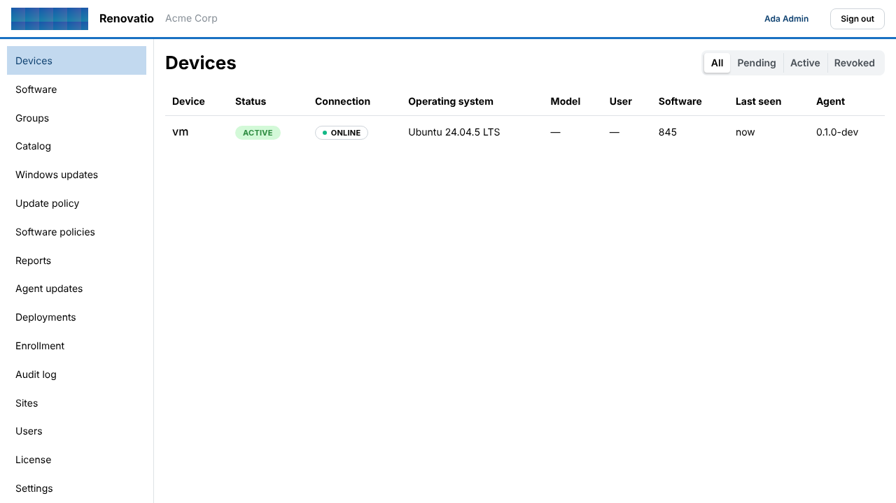
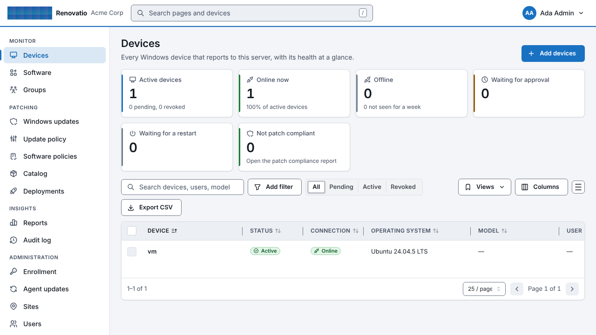
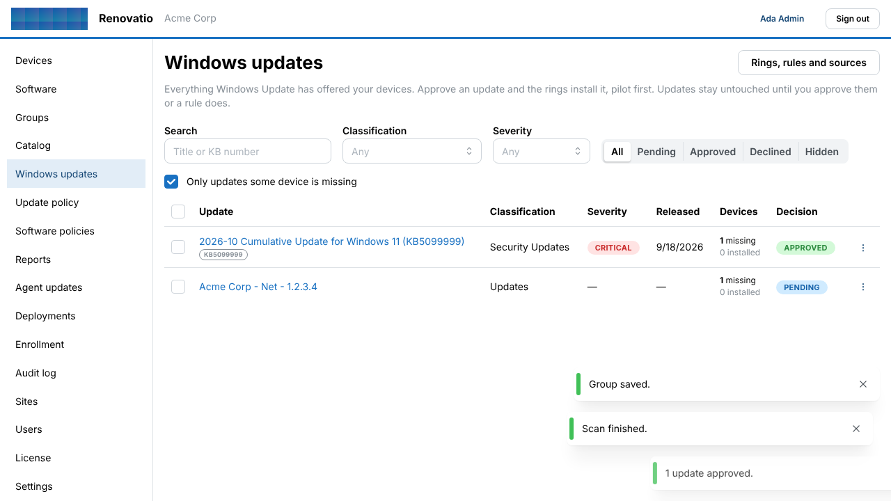
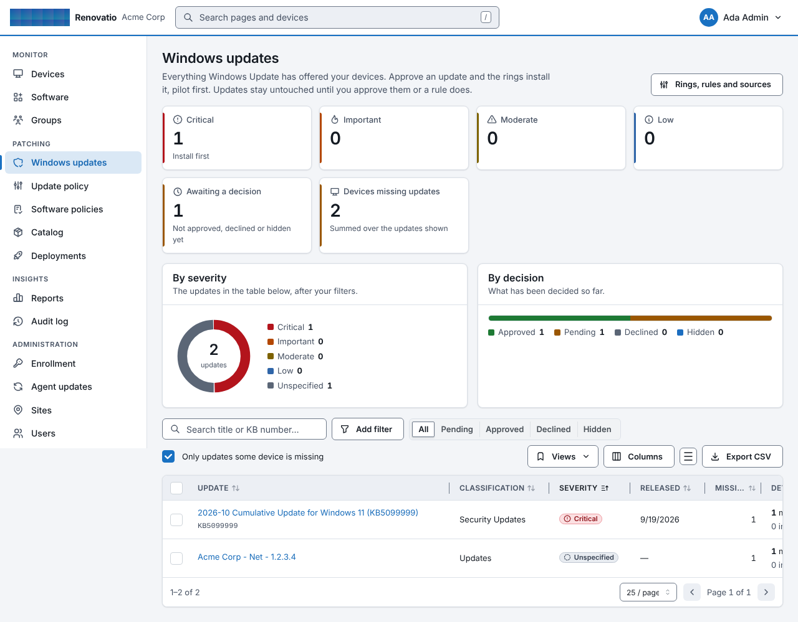
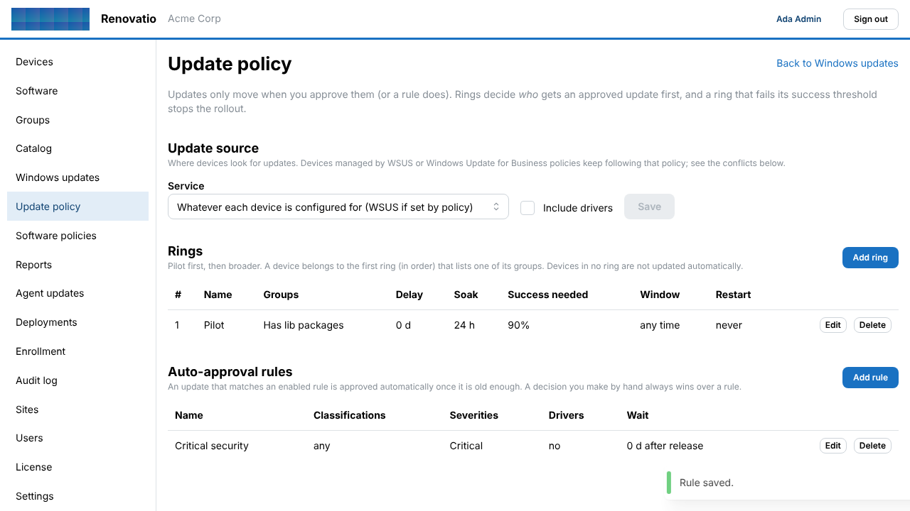
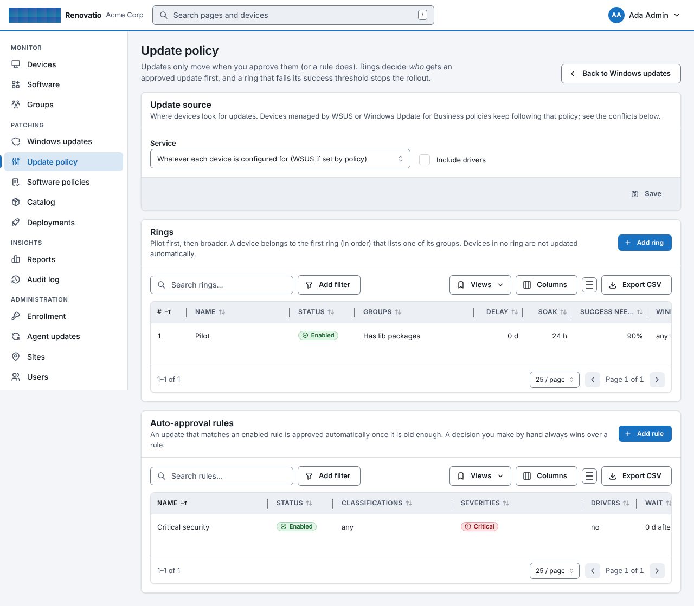
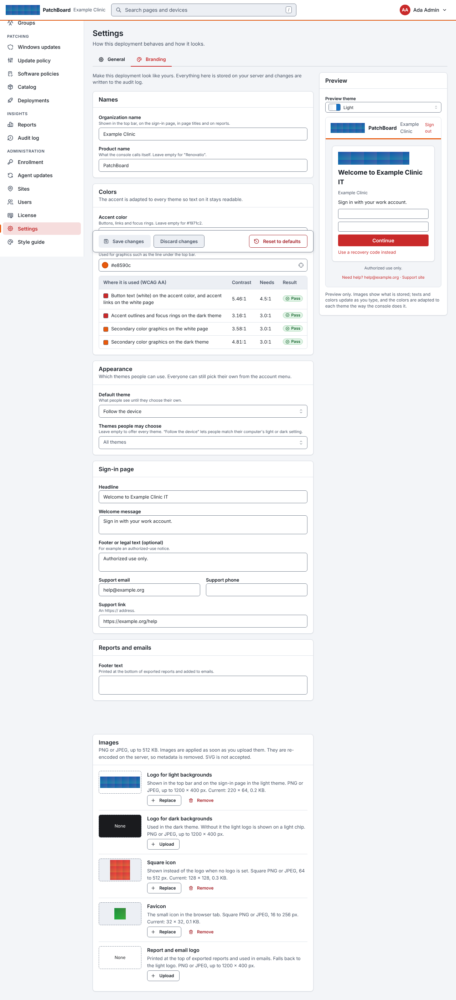

# Console design: before and after

Screenshots of the same three pages from the same end-to-end run (1280 px wide, one enrolled test device), before and after the redesign (decision D93; component reference in `web/src/ui/README.md`, live at `/styleguide` for administrators).

| Page | Before | After |
|---|---|---|
| Devices |  |  |
| Windows updates |  |  |
| Update policy |  |  |

The branding page (administrators; includes the theme settings):

## Themes

The style guide in each of the five themes (every one passes the WCAG AA contrast test in `web/src/design/themes.test.ts`, and axe finds no violations in any of them):

| Light | Slate | Dark | Midnight | High contrast |
|---|---|---|---|---|
| [light](styleguide-light.png) | [slate](styleguide-slate.png) | [dark](styleguide-dark.png) | [midnight](styleguide-midnight.png) | [contrast](styleguide-contrast.png) |

Regenerate the "after" images with `LIBREPATCH_SCREENSHOTS=<dir> scripts/gui-e2e.sh` (the files are `04-devices`, `16-updates-catalog`, `17-update-policy`, `27-branding` and `29-styleguide-<theme>`).
